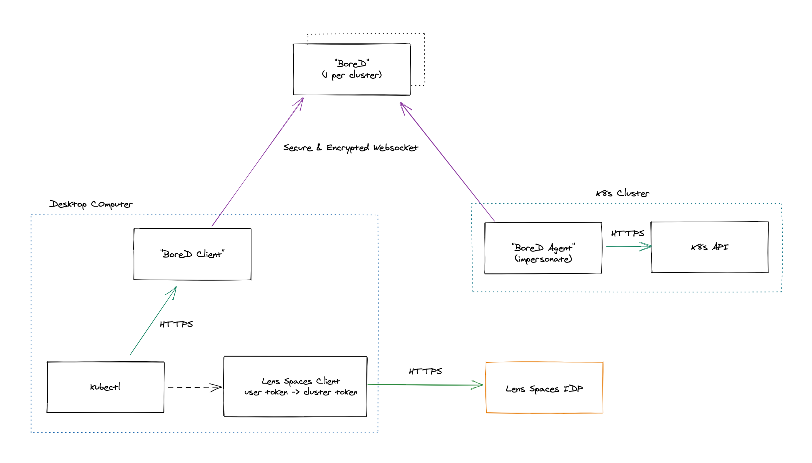

# BoreD

```
bore (verb)
/bɔː/
```

> Make (a hole) in something with a tool or by digging.

BoreD is a secure, end-to-end encrypted, reverse tunnel daemon for Kubernetes API access. It's designed to work with [Lens - The Kubernetes IDE](https://github.com/lensapp/lens). BoreD combines a client-side reverse proxy, websocket tunnels and end-to-end encryption to expose your Kubernetes API to users.

## Features

- Secure tunnel from users desktop to Kubernetes API
- Impersonation based on IdP issued JWT tokens
- Works behind firewalls / NAT
- End-to-end encryption, BoreD daemon cannot see the traffic it tunnels
- Link encryption using TLS for websockets (`wss://`)
- Automatic reconnects
- Handles multiple Kubernetes clusters

## Architecture



- [BoreD](./README.md)
- [BoreD Agent](https://github.com/lensapp/bored-agent)

## JWT Tokens

### Client

```json
{
  "sub": "username",
  "groups": [],
  "clusterId": "cluster-uuid",
  "aud": "https://bored.domain.com/"
}
```

### Agent

```json
{
  "sub": "cluster-uuid",
  "aud": "https://bored.domain.com/"
}
```

## Browser clients

Client WebSockets (`/client/connect` and `/client/presence`) accept the same IdP
JWT through subprotocols when an Authorization header cannot be set:

```js
const socket = new WebSocket("wss://bored.domain.com/client/connect", [
  "bored",
  `bored-auth.${token}`,
]);
```

Offer exactly one `bored-auth.` credential together with `bored`. The server
negotiates `bored`, never the credential. Omitting `bored` makes the handshake
fail before an authentication close code can be received; the credential is never
echoed to make an incomplete protocol offer succeed. Use `wss://` and redact credential
subprotocols from infrastructure logs, just as for Authorization headers.
Bearer Authorization headers take precedence, including invalid or malformed
Bearer credentials (which fail without fallback). Other schemes, such as cached
HTTP Basic credentials forwarded by an ingress, do not override a subprotocol
JWT. Agent authentication is unchanged.

## Encryption

### Transport Layer Encryption

Both client and agent use websockets to establish socket connection to BoreD daemon. This transport layer can be secured using Secure WebSockets (TLS).

### Tunnel Encryption

BoreD tunnel encryption is done in two phases. Tunneled data is being encrypted using symmetric encryption (AES-256-GCM). Key exhange is done using asymmetric encryption (RSA-4096) where BoreD agent has the private key and the public key is distributed to clients via BoreD daemon.

### Release

1. Make a PR that updates version in package.json
2. Create and push git tag, e.g. "v0.10.4"

## License

Copyright (c) 2021 Mirantis, Inc.

Licensed under the [MIT license](./LICENSE).
